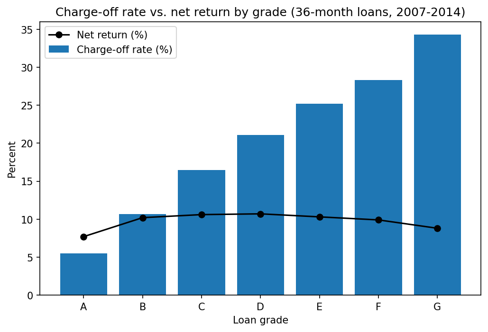

# Credit Risk Analysis

Analyzing public loan data with SQL and Python to identify which borrower segments carry the highest default risk.

## Question
Which borrower segments carry the highest default risk, and how should a lender adjust pricing or approval criteria?

## Tools
- SQL (SQLite)
- Python (pandas, matplotlib)
- Tableau (dashboard planned)

## Data Notes
- Source: Lending Club loan data (2007-2018, about 2.26 million loans) from Kaggle.
- My first 100,000 rows were almost all active loans (about 97% "Current"), with only 19 charge-offs, so I loaded the full file into SQLite in chunks.
- I analyze only completed loans (status Fully Paid or Charged Off, about 1.3 million). Active, late, and policy-exception loans are excluded.

## Findings
- Roughly 20% of completed loans were charged off.
- Charge-off rates rise steadily with loan grade, from 6.1% (grade A) to 50.1% (grade G).
- Grades B and C account for about 57% of completed loans.
- Net return by grade looks very different depending on which loans are included. Across all completed loans, low grades appear to lose money, but this is distorted by recent loans that are mostly still active.
- Restricting to 36-month loans issued through 2014, which have all had time to finish, every grade was profitable, with lifetime returns of about +8.8% to +10.7%.
- In that cleaner sample, riskier grades did not earn higher returns than safer ones. Grades B-F all returned about 10%, while grade A returned 7.7%. The higher interest on risky loans roughly offset their higher charge-off rates.
- Small business loans had the highest charge-off rate by purpose (22.1%, versus 10.2% for car loans). The gap holds within every loan grade (for example, 12.5% vs 5.5% in grade A), so purpose adds risk beyond what grade captures. Grade still explains far more of the variation than purpose does.

## Limitations
- Net return is a lifetime figure (total payments received vs. amount funded). It is not annualized and ignores payment timing, lender costs, and taxes.
- Results for recent issue years are biased toward early charge-offs, so conclusions about profitability are preliminary.
- The clean comparison covers only 36-month loans issued 2007-2014, so it may not reflect later years or economic conditions. Grade G has only 274 loans in that sample, so its result is less reliable.
- Results are descriptive, not causal. I did not control for other factors like income or loan purpose.

## Status
In progress. Core analysis by loan grade is complete; Tableau dashboard is next.

## Files
- `01_data_exploration.ipynb`: the full analysis (SQL queries, results, and chart).
